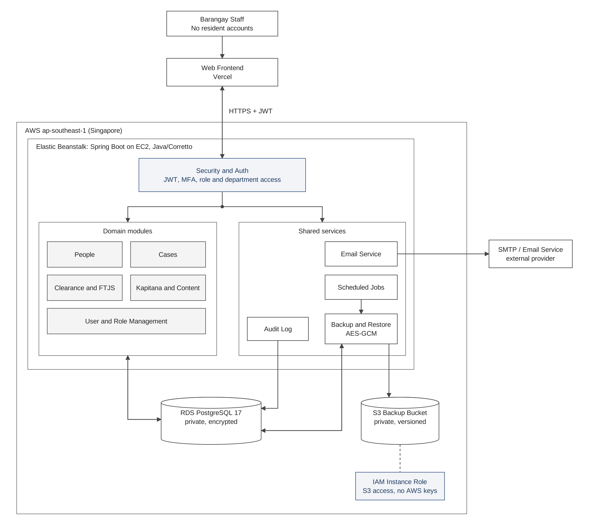
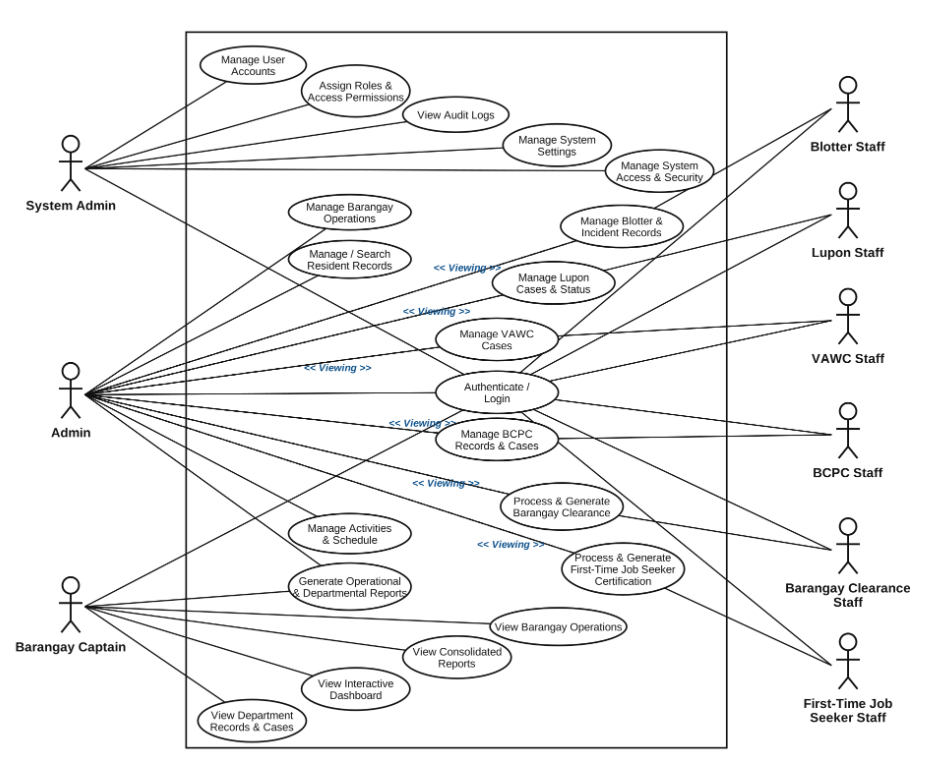
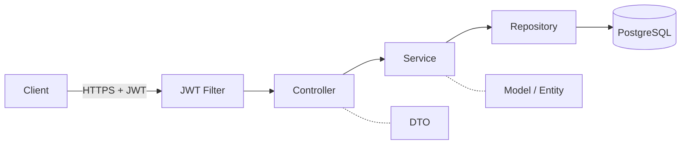
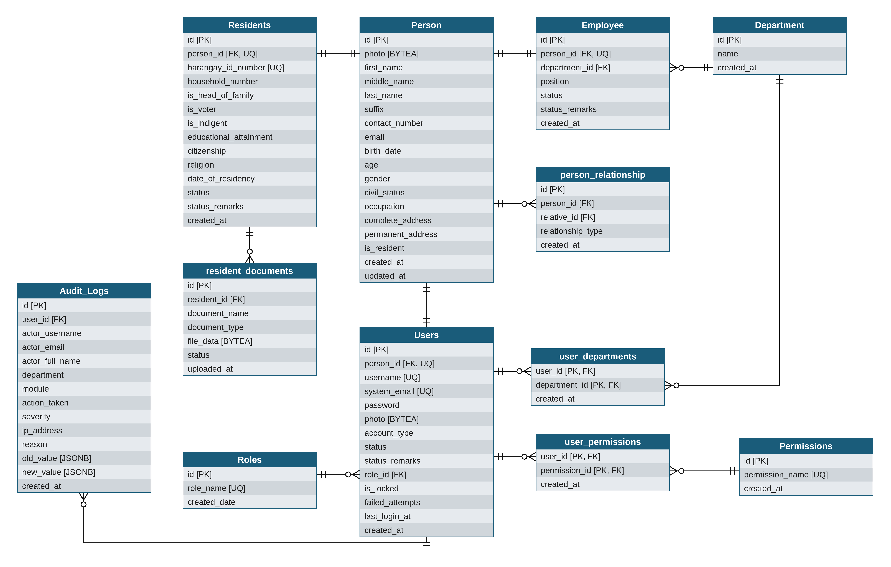
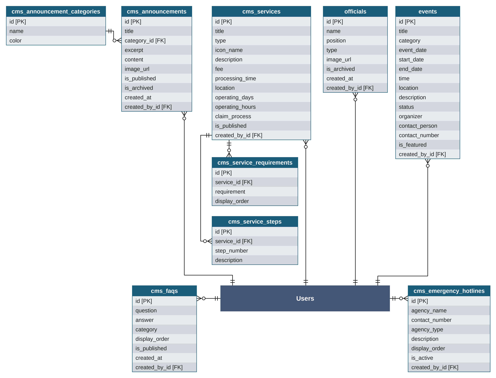
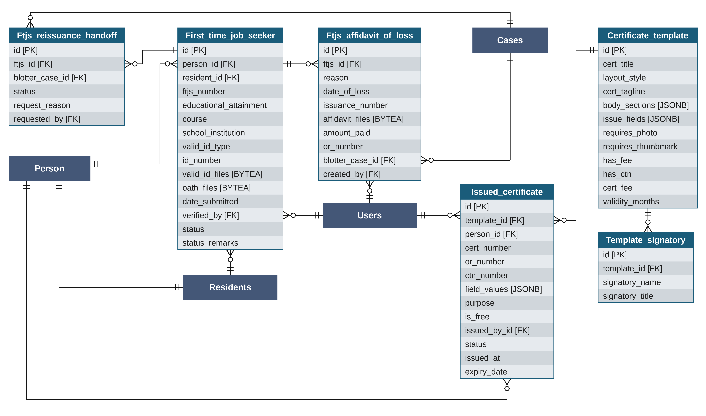
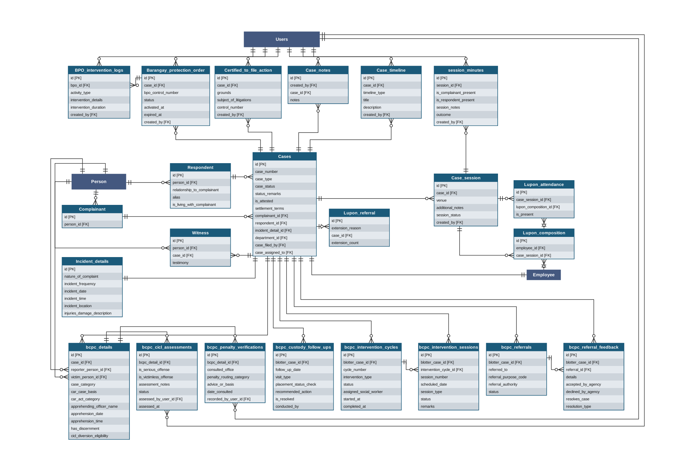
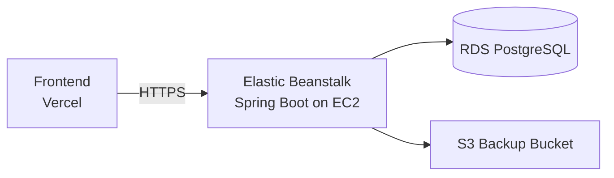

# SerbisyoKo Backend

REST API for **SerbisyoKo: A Web-Based Barangay Operations Management System** for Barangay Ugong, Valenzuela City.

[Frontend Repository](https://github.com/jeremiahmadronio/barangay-ugong-management-system-frontend)

> **Full project information:** [maya-maya.vercel.app](https://maya-maya.vercel.app)

## Overview

SerbisyoKo replaces manual logbooks and paper records with one centralized system. This repository is the backend. It handles authentication, role-based access, business rules, and data storage for eight modules: six core departments (Blotter, Lupon, VAWC, BCPC, Barangay Clearance, First-Time Job Seeker) and two supporting modules (Kapitana Officer Directory and Content Management).

Residents are encoded once and reused across departments. Residents do not have accounts. Only authorized barangay staff can log in.

**Quality standard.** The system is designed around ISO/IEC 25010:2023, the software product quality model. In this backend, the characteristics map to the following:

| ISO/IEC 25010:2023 | How the backend addresses it |
| ------------------ | ---------------------------- |
| Functional Suitability | Shared resident records and case tracking across departments |
| Security | BCrypt, JWT, RBAC, department isolation, MFA, AES encryption, SQL injection prevention, input validation, CORS, audit logs |
| Reliability | Transactions that roll back failed operations, scheduled cleanup and auto-archive |
| Maintainability | Layered modules, global exception handler, 59 unit test files, clean code architecture, and Javadoc documentation |
| Flexibility (Portability) | Docker image, environment-based configuration |
| Safety | AES-GCM encrypted backups to S3, with restore |

## Features

- Shared resident records and case tracking across departments
- Role-based and department-based access control
- Two-step verification by email code or authenticator app
- Audit logs for logins and record changes
- AES encryption for stored data and database backups, with restore
- Transactions that roll back failed operations
- Centralized error handling and a layered codebase
- Docker setup for consistent deployment

## Tech Stack

| Layer | Technology |
| ----- | ---------- |
| Language | Java 24 (Eclipse Temurin) |
| Framework | Spring Boot 3.5.14, Spring Security 6.5.x |
| Database | PostgreSQL 17 |
| Authentication | JJWT 0.11.5, BCrypt, TOTP (`dev.samstevens.totp` 1.7.1) |
| Cloud | AWS SDK for Java v2 (2.30.36) |
| API Docs | springdoc-openapi-starter-webmvc-ui 2.8.5 |
| Other | Spring Boot Starter Mail, Actuator, Validation, dotenv-java 3.0.0, Docker |
| Testing | JUnit 5, Mockito, AssertJ, H2, spring-security-test |

## Getting Started

**Requirements:** JDK 24, a running PostgreSQL instance, and Docker (optional).

No `docker-compose.yml` is included. Run PostgreSQL separately (locally installed, or `docker run postgres:17`) and point `DB_URL` to it.

```bash
git clone https://github.com/jeremiahmadronio/barangay-ugong-management-system-backend
cd serbisyoko-backend
cp .env.example .env      # then fill in the values
```

**Run with Docker**

```bash
docker build -t serbisyoko-backend .
docker run -p 8080:8080 --env-file .env serbisyoko-backend
```

**Run without Docker** (app only)

```bash
./mvnw spring-boot:run
```

**Build a production jar** (skips tests)

```bash
./mvnw clean package -DskipTests
```

The API runs at `http://localhost:8080`.

**Notes**

- No database migration tool (Flyway/Liquibase) is used. Schema is managed by `spring.jpa.hibernate.ddl-auto=update`.
- File upload limits: 20 MB per file, 25 MB per request.
- The app listens on port `8080` by default (change with `SERVER_PORT`).
- The Docker image uses Eclipse Temurin 24. The Elastic Beanstalk deployment runs on Amazon Corretto 25.
- The Docker image is a multi-stage build (`eclipse-temurin:24-jdk-alpine` → `24-jre-alpine`), runs as a non-root user, includes `postgresql-client` for `pg_dump` backups, and has a health check on `/actuator/health`. Timezone is Asia/Manila.

### Environment variables

| Variable | Description |
| -------- | ----------- |
| `SERVER_PORT` | Port the app runs on (default 8080) |
| `DB_URL` | PostgreSQL JDBC URL |
| `DB_USERNAME` | Database username |
| `DB_PASSWORD` | Database password |
| `JWT_SECRET` | Secret key for signing JWT tokens |
| `JWT_EXPIRATION` | Token expiry in ms (default: 86400000 = 24h) |
| `ENCRYPT_KEY` | Base64-encoded AES key for data encryption |
| `SMTP_PORT` | Email SMTP port |
| `SMTP_USERNAME` | Gmail address for sending OTP/notifications |
| `SMTP_PASSWORD` | Gmail App Password |
| `AWS_S3_BUCKET` | S3 bucket name for encrypted backups |
| `AWS_REGION` | AWS region (e.g. `ap-southeast-1`) |
| `AWS_ACCESS_KEY_ID` | Only needed for local/Docker dev; not needed on AWS EB with IAM role |
| `AWS_SECRET_ACCESS_KEY` | Only needed for local/Docker dev; not needed on AWS EB with IAM role |
| `ROOT_EMAIL` | Email of the first Root Admin account (auto-created on startup) |
| `ROOT_PASSWORD` | Password of the first Root Admin account |
| `CORS_ALLOWED_ORIGINS` | Frontend URL allowed to call the API |
| `SWAGGER_CONTACT_NAME` | Contact name shown in Swagger UI |
| `SWAGGER_CONTACT_EMAIL` | Contact email shown in Swagger UI |
| `JAVA_TOOL_OPTIONS` | Optional JVM flags, e.g. `-XX:MaxRAMPercentage=65.0` to limit heap on small instances |

Never commit your real `.env` file.

## API Documentation

With the server running:

- **Swagger UI:** http://localhost:8080/swagger-ui/index.html
- **OpenAPI JSON:** http://localhost:8080/v3/api-docs

REST endpoints are under `/api/v1/...`. Operational endpoints sit outside that prefix: `/actuator/health`, `/swagger-ui/index.html`, and `/v3/api-docs`.

The API title is **"UgongConnect: Barangay Ugong Management System API"** (v1.0.0). All endpoints require a JWT Bearer token except login and the public content endpoints (see below).

1. Call `POST /api/v1/auth/login` with your credentials to get a token.
2. Click **Authorize** in Swagger UI and enter: `Bearer <your_token>`

### Core endpoints

A summary of the core business routes. Swagger UI has the full list. Routes are relative to the base path.

| Module | Base path | Core routes | Purpose & Workflow |
| ------ | --------- | ----------- | ------------------ |
| **Auth and MFA** | `/api/v1/auth` | `POST /login`<br>`POST /verify-mfa`<br>`POST /forgot-password/reset` | Login, multi-factor verification (Email OTP or TOTP Authenticator), password reset |
| **Residents** | `/api/v1/residents` | `GET /suggestions`<br>`POST /`<br>`GET /{id}/details`<br>`PATCH /{id}/archive` | Master resident profile encoding, auto-suggest search, relationship linking, archival |
| **Blotter (Mediation)** | `/api/v1/blotter` | `POST /`<br>`POST /{caseId}/mediation`<br>`POST /mediation/{sessionId}/minutes`<br>`PATCH /{id}/status`<br>`POST /refer/{caseNumber}`<br>`POST /{id}/reopen` | Incident filing (For the Record / Formal Complaint), summon & mediation scheduling, hearing minutes & settlement terms, referral to Lupon, case reopening |
| **Lupon (Conciliation)** | `/api/v1/lupon` | `GET /{caseId}/pangkat`<br>`POST /{caseId}/conciliation`<br>`POST /conciliation/{sessionId}/minutes`<br>`POST /{caseId}/extend` | Katarungang Pambarangay conciliation, 3-member Pangkat formation, hearing minutes, 15-day extension, Certificate to File Action (CFA) tracking |
| **VAWC** | `/api/v1/vawc` | `POST /`<br>`POST /{caseId}/bpo/activate`<br>`POST /{caseId}/bpo/serve`<br>`POST /{caseId}/referrals`<br>`POST /{caseId}/referrals/{refId}/feedback` | Case intake, Barangay Protection Order (BPO) activation and service, formal referrals to PNP Women's Desk / DSWD with feedback logging |
| **BCPC** | `/api/v1/bcpc` | `POST /car`<br>`POST /cicl`<br>`PUT /{caseId}/custody-log`<br>`POST /{caseId}/interventions`<br>`POST /{caseId}/interventions/{intId}/progress` | Children at Risk (CAR) and Children in Conflict with the Law (CICL) case handling, guardian/DSWD custody logs, diversion and intervention progress tracking |
| **Clearance** | `/api/v1/clearance` | `GET /search-resident`<br>`POST /issue-clearance` | Real-time derogatory verification against active/pending blotter & lupon cases before clearance certification issuance |
| **FTJS** | `/api/v1/ftjs` | `GET /search-resident`<br>`POST /entry`<br>`POST /re-issuance-request/{id}` | RA 11261 First-Time Job Seeker certification, one-time issuance safeguard, lost certificate re-issuance request and verification |
| **Officers (Kapitana)** | `/api/v1/officers`<br>`/api/v1/kapitana` | `POST /`<br>`GET /lupon`<br>`GET /dashboard-kpi` | Barangay official directory, Lupon Tagapamayapa roster assignment, executive dashboard for Punong Barangay |
| **Users & RBAC** | `/api/v1/users`<br>`/api/v1/system-users` | `POST /create-admin`<br>`PATCH /{id}/lock`<br>`PATCH /{id}/status` | Role-Based Access Control (RBAC), department isolation, account lock/unlock, staff onboarding |
| **Audit & Backup** | `/api/v1/audit-logs`<br>`/api/v1/admin/backups` | `GET /`<br>`POST /admin/backups/trigger`<br>`GET /admin/backups/schedule` | Comprehensive system audit trails, automated AES-GCM encrypted database backups to Amazon S3 |
| **Public CMS** | `/api/v1/cms/announcements`<br>`/api/settings` | `GET /public`<br>`GET /settings` | Publicly accessible portal announcements, emergency hotlines, and barangay profile settings |

## Architecture

### System overview

<p align="center">
  <a href="readme_images/high_level_arch.png" target="_blank">
    
  </a>
</p>

The high-level architecture is organized into four core functional tiers:

1. **Client & Presentation Tier:** Authorized barangay personnel access the web application through modern browsers, communicating strictly over HTTPS with stateless JSON Web Tokens (JWT).
2. **Security & API Routing Tier:** All requests are intercepted by Spring Security (`JwtAuthenticationFilter`), which verifies token authenticity, validates role permissions (RBAC), and enforces strict department-level isolation before dispatching to controllers.
3. **Application & Business Logic Tier:** Modularized domain services encapsulating business rules, audit logging, and transaction management:
   - **Case Management:** Blotter mediation, Lupon conciliation, VAWC protection, and BCPC child welfare.
   - **Demographic & Public Services:** Unified resident profiling, officer directory, clearance issuing with derogatory check, and FTJS certification.
   - **Cross-Cutting Services:** Global exception handling, automated background schedulers (retention & auto-archival), and email dispatch (Gmail SMTP).
4. **Data & Cloud Storage Tier:**
   - **PostgreSQL 17 Database:** Primary relational datastore storing transactional entities with AES-encrypted sensitive fields.
   - **Amazon S3:** Dedicated off-site cloud storage holding AES-GCM encrypted database backups with automated retention lifecycles.

### Use Case Diagram

The operational boundaries and interactions between barangay personnel roles (Root Admin, System Admin, Department Officers/Staff, and Residents) and the system modules:

<p align="center">
  <a href="readme_images/use_case.png" target="_blank">
    
  </a>
</p>

### Layers

The codebase is layered. Each module (blotter, clearance, people, and so on) has the same layers:



| Layer | Role |
| ----- | ---- |
| **Controller** | Receives the request, validates the DTO, returns the response |
| **Service** | Business rules, transactions, audit logging |
| **Repository** | Spring Data JPA queries |
| **Model** | JPA entities mapped to database tables |
| **DTO** | Request and response objects, so entities are never exposed directly |

**Data flow:** the request passes the JWT filter and department/role checks, reaches the controller, and goes to the service. The service reads or writes entities through the repository. The result is mapped back to a DTO and returned. A failure rolls back the transaction, and the global exception handler formats the error.

Supporting services: email (OTP and notifications), AES-GCM encrypted backups to S3, and scheduled tasks (auto-archive, cleanup).

### Database design

The database schema is organized across domain modules. Click any diagram below to view full resolution:

#### Figure 7.0: Core Entity Relationship Diagram (p. 62)
*(Residents, Persons, Officers, Roles, Permissions, and System Administration)*
<p align="center">
  <a href="readme_images/erd_core.png" target="_blank">
    
  </a>
</p>

#### Figure 7.1: Content Management System (CMS) Entity Relationship Diagram (p. 63)
*(Public Portal, Announcements, Officials, Barangay Services, and System Settings)*
<p align="center">
  <a href="readme_images/erd_content.png" target="_blank">
    
  </a>
</p>

#### Figure 7.2: First Time Job Seeker (FTJS) and Clearance Entity Relationship Diagram
*(Clearance Templates, Issued Certifications, FTJS Records, Re-issuances, and Logs)*
<p align="center">
  <a href="readme_images/erd_ftjs&clearance.png" target="_blank">
    
  </a>
</p>

#### Figure 7.3: Case Management Entity Relationship Diagram (p. 65)
*(Blotter, Lupon Conciliation, VAWC, BCPC, Sessions, Minutes, Summons, Evidences, and Witnesses)*
<p align="center">
  <a href="readme_images/erd_case.png" target="_blank">
    
  </a>
</p>

## Project Structure

Each module under `src/main/java/com/barangay/` contains `controller/`, `dto/`, `model/`, `repository/`, and `service/`.

```
src/main/java/com/barangay/
├── auth/                # Login, MFA, JWT
├── cases/
│   ├── blotter/         # Blotter cases (also has projection/)
│   ├── lupon/           # Lupon conciliation
│   ├── vawc/            # VAWC cases
│   ├── bcpc/            # BCPC child protection cases
│   └── shared/          # Shared Case, complainant, respondent, witness
├── clearance/           # Barangay Clearance
├── ftjs/                # First-Time Job Seeker
├── kapitana/            # Officer Directory / Barangay Captain
├── contentmanagement/   # Announcements and barangay content
├── people/              # Residents and person records
├── usermanagement/      # Admin users, departments, roles, permissions
└── zshared/             # Cross-cutting concerns
    ├── audit/           # Audit log
    ├── backup/          # AES-encrypted S3 backup
    ├── config/          # Security, CORS, OpenAPI, AWS S3
    ├── dataseeds/       # Root admin and role seeders
    ├── enumerated/      # Global enums
    ├── exception/       # Global exception handler
    ├── notification/    # Email service
    ├── scheduler/       # Scheduled tasks
    ├── security/        # JWT filter, security constants
    └── util/, dto/, entity/, mapper/, repository/

src/test/java/com/barangay/       # 59 unit test files, mirrors the main packages
├── auth/                # Login, MFA, TOTP
├── cases/               # Blotter, Lupon, VAWC, BCPC services, archive, reports
├── clearance/ ftjs/ kapitana/ contentmanagement/
├── people/              # Officer, person, resident
├── usermanagement/      # Admin, department, permission, user
├── zshared/
│   ├── audit/ backup/ notification/
│   ├── scheduler/       # 7 scheduler tests
│   └── security/        # JWT, AES, department security, security utils
└── BarangayApplicationTests

src/main/resources/
└── application.properties   # Single config file
```

## Testing

Tests use JUnit 5, Mockito, AssertJ, and an in-memory H2 database under the `test` profile (`@ActiveProfiles("test")`). No PostgreSQL is needed.

```bash
./mvnw test                           # run all tests
./mvnw test -Dtest=BlotterCaseServiceTest   # run one class
```

## Security

- **Authentication & MFA:** Passwords hashed with BCrypt, stateless signed JWTs, and 2-step verification (Email OTP or TOTP Authenticator).
- **Access Control:** Role-Based Access Control (RBAC) and strict department isolation (e.g., Blotter staff cannot access sensitive VAWC or BCPC cases).
- **Injection & Input Defense:** Parameter-bound queries via Spring Data JPA (SQL injection prevention) and Jakarta Bean Validation (`@Valid`) on all incoming request payloads.
- **Data Encryption:** Sensitive records encrypted with AES (key loaded via environment variables, not in codebase).
- **Encrypted Backups:** Automated database backups encrypted with AES-GCM and verified with SHA-256 before upload to private Amazon S3.
- **Database at Rest:** Private AWS RDS instance with encryption at rest, completely inaccessible from the public internet.
- **Network & Headers:** Strict CORS origin whitelist (`CORS_ALLOWED_ORIGINS`), secure file upload validation (format, signature, and size), and OWASP security headers.
- **Transport Security:** HTTPS/TLS enforced in all deployed environments (`sslmode=require`).

To report a vulnerability or for inquiries, email [jeremiahmadronio2003@gmail.com](mailto:jeremiahmadronio2003@gmail.com).

## Deployment

Deployed on AWS in the **ap-southeast-1 (Singapore)** region.



| Service | Setup |
| ------- | ----- |
| **RDS** | PostgreSQL 17, single-AZ `db.t3.medium`, 20 GiB gp3 with autoscaling, encrypted, automated backups (7 days), no public access |
| **S3** | Private backup bucket with versioning, default encryption, and a 30-day lifecycle rule |
| **Elastic Beanstalk** | Java (Corretto 25, Amazon Linux 2023), single instance on `t3.small`, health check at `/actuator/health` |
| **IAM** | The Elastic Beanstalk EC2 role has `s3:PutObject`, `s3:GetObject`, and `s3:ListBucket` on the backup bucket only. No AWS access keys in the app |
| **Frontend** | Vercel (build with `npm run build`, output `dist`) |

**Steps**

1. Create the RDS database and wait until it is **Available**.
2. Create the S3 backup bucket and attach the S3 policy to the Elastic Beanstalk EC2 role.
3. Build the jar, then upload it in the Elastic Beanstalk console:

   ```bash
   ./mvnw clean package -DskipTests
   ```

4. Set the [environment variables](#environment-variables). Use the RDS endpoint in `DB_URL` and add this to the end of it:

   ```
   ?sslmode=require
   ```

5. Deploy the frontend, then put its URL in `CORS_ALLOWED_ORIGINS`.

**Notes**

- The app runs on port `8080`. [TODO: confirm how the Elastic Beanstalk proxy maps to port 8080.]
- On a single small instance, memory use can reach about 94%. Set `JAVA_TOOL_OPTIONS=-XX:MaxRAMPercentage=65.0` to leave room for the OS and the proxy.

## Authors

**Jeremiah D. Madronio**

BS Information Technology, STI College Novaliches · October 2026

## License

MIT. See [`LICENSE`](LICENSE).
